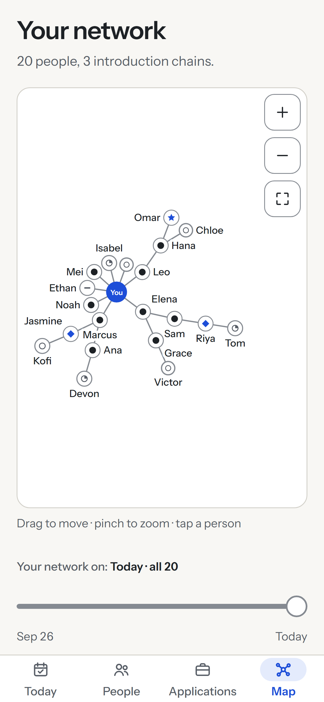

# Orbit

A personal CRM for an internship search: the people you meet, who
introduced you to whom, what you talked about, when to follow up, and
every application, with a map of your network at the centre.

**Live:** [orbit-dk.vercel.app](https://orbit-dk.vercel.app) · Tap **Try the demo** on the
login screen to look around a sample network, no email needed.



What's in it:

- **Today**: who to follow up with (overdue, today, the next 7 days), and
  your application counts.
- **People**: everyone you've met, by stage, with search; each person's
  page has how you met, who introduced you, notes, applications and a
  timeline. Logging an interaction takes two taps and offers a follow-up.
- **Applications**: every internship application with its status, a quick
  status change, and an import that reads rows pasted from a spreadsheet.
- **Map**: you in the middle, everyone around you, lines for who
  introduced whom; pinch, pan, tap a person, and watch it grow over time.
  The same network is listed under it.
- **Try the demo**: a shared sample account with 20 people and 15
  applications, put back fresh for each visitor.

Mobile-first. Next.js 16 · React 19 · Tailwind 4 · Supabase · Vitest +
PGlite · Playwright + axe. The plan, every decision and the review log
are in [`plans/crm.md`](plans/crm.md).

## Run it

```bash
npm install
npm run dev          # http://localhost:3200 (not 3000: Hold and Bitewise live there)
npm test             # unit tests and real-Postgres (PGlite) database tests
npm run test:e2e     # Playwright on the shared demo account
npm run screens      # screenshots for the design review (docs/screenshots/)
```

If port 3200 is taken, run the app on another port and point the tests at
it: `npx next dev -p 3201`, then `BASE_URL=http://localhost:3201 npm run test:e2e`.
Screenshots are taken from a production build (`npx next build`, then
`npx next start -p 3300` and `BASE_URL=http://localhost:3300 npm run screens`).

Against the live copy (`BASE_URL=https://orbit-dk.vercel.app npx playwright test`)
only the smoke and install checks run: the demo account is shared and
live, so they sign in once like a visitor, take back the one thing they
save, and press Reset demo only if that fails. The full suite is for
local runs.

## How it's built

Every feature went through three read-only reviewer agents
(`.claude/agents/`): **logic-checker** on the plan, then **code-reviewer**
and **design-critic** (on Playwright screenshots at 390 × 844, light and
dark) on the result. Every finding and what was done about it is logged
under "Reviews" in [`plans/crm.md`](plans/crm.md).

## Install it on your phone

- **iPhone (Safari):** open the app, tap Share, then **Add to Home Screen**.
- **Android (Chrome):** open the app, tap the ⋮ menu, then **Install app**
  (or **Add to Home screen**).

It opens full screen, like an app, on Today. There's no offline mode:
everything lives in Supabase, so what's already on screen stays, a save
without a connection says it couldn't save, and going to a screen that
hasn't loaded yet shows the browser's offline page.

## Environment

`.env.local` (and the Vercel project) needs four values, shared with
Hold and Bitewise:

| Name | What |
|---|---|
| `NEXT_PUBLIC_SUPABASE_URL` | the Supabase project URL |
| `NEXT_PUBLIC_SUPABASE_PUBLISHABLE_KEY` | the publishable (anon) key; RLS limits what it can do |
| `DEMO_EMAIL`, `DEMO_PASSWORD` | the shared demo account behind "Try the demo" (server-only) |

No service-role key is used anywhere.

## Supabase setup

1. Paste each file in `supabase/migrations/` into the SQL editor, in name
   order, once. Never edit one that's applied; add a new file.
2. Authentication → URL Configuration → Redirect URLs: add
   `http://localhost:3200/auth/confirm` and the deployed
   `https://orbit-dk.vercel.app/auth/confirm` (exact addresses, no
   wildcards). Leave the Site URL alone: Hold and Bitewise use it.
